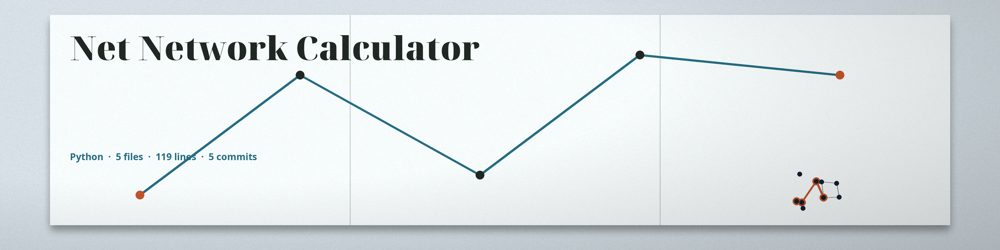

# net-network-calculator
A CLI tool that takes an IP address and a subnet mask (CIDR notation) as input and calculates the network address, broadcast address, usable host range, and total number of hosts in the subnet. Useful for network segmentation and address planning. Focused on basic network operations.

## Install
`git clone https://github.com/ShadowGuard-AI/net-network-calculator`
`pip install -r requirements.txt`

## Usage
`python3 main.py IP_ADDRESS CIDR_MASK`

## Parameters
- `-h`: Show help message and exit
- `ip_address`: The IP address (e.g., 192.168.1.1). Required.
- `cidr_mask`: The CIDR mask (e.g., 24). Required, an integer from 0 to 32. IPv6 is not supported, because masks above 32 are rejected.

## Verified behavior
- `192.168.1.10 24` prints network 192.168.1.0, broadcast 192.168.1.255, first usable 192.168.1.1, last usable 192.168.1.254, total hosts 256.
- `10.0.0.1 8` prints network 10.0.0.0, broadcast 10.255.255.255, first usable 10.0.0.1, last usable 10.255.255.254, total hosts 16777216, and returns promptly.
- Host bits in the input are masked without a warning: the report describes the network the input falls in, not the address typed. For example, 192.168.1.55 with mask 24 reports the .0 network.
- "Total Hosts" counts every address in the block, network and broadcast included. A /24 reports 256 even though only 254 are usable.
- /31 and /32 report "N/A (Network too small)" for both usable hosts, even though /31 point to point links use both addresses as hosts.
- An invalid IP address and a mask of 33 both print an error and exit 1.
- Code fix in this wave: the usable host range is now computed by address arithmetic (network address plus 1, broadcast address minus 1) instead of materializing the full host list. Before the fix, a large block such as a /8 built millions of entries to read its two ends.

## License
See LICENSE.
